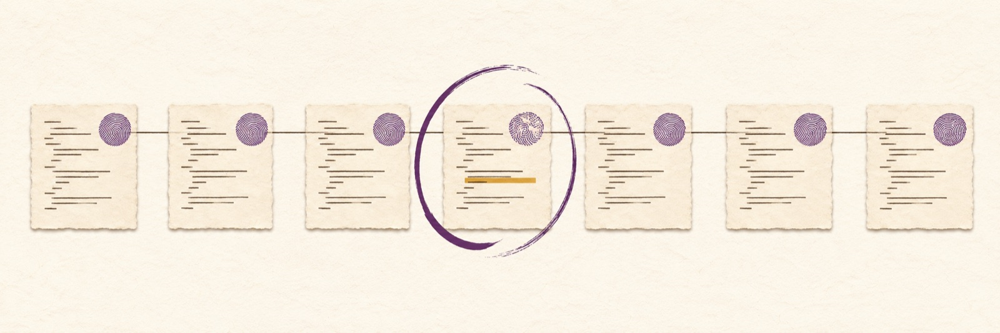

# kioku

[English](README.md) | Français

<picture>
  <source media="(prefers-color-scheme: dark)" srcset="docs/assets/banner-dark.jpg">
  
</picture>

kioku est un cache local de **codes de sortie réussis**. Par défaut, il
exécute la commande à chaque fois. La réutilisation par traçage est une option
réservée à un profil étroit et à des hypothèses explicites.

[CI](https://github.com/Rushford444/kioku/actions/workflows/ci.yml)
[](LICENSE)
[](https://github.com/Rushford444/kioku/releases)

## Le problème

Une personne lance un contrôle, modifie un fichier sans rapport, puis relance
le contrôle en attendant une revue. Un cache ordinaire peut manquer une
dépendance absente de sa clé. Kioku commence par exécuter la commande ; la
réutilisation exige une affirmation explicite sur la stabilité et le
déterminisme. Un hit ne restitue ni sortie ni artefact : ne l’utilisez pas si
une étape ultérieure en a besoin.

## Démonstration

Capture Linux/aarch64 avec kioku 0.1.0 et le traceur épinglé
(sha256 `0e69fa12…cf28`). Le binaire d’aide est un vérificateur ELF statique,
donc admissible au traçage. Le premier run enregistre ce que le binaire
observe ; le second confirme ces dépendances. Le troisième est un hit tracé :
`cached (pass, 189 ms saved)`. Un hit ne rend que le code de sortie réussi en
cache ; il ne restitue aucune sortie.

```text
$ kioku run --trust-trace -- ./check input.txt
executed (exit 0, 157 ms)
$ kioku run --trust-trace -- ./check input.txt
executed (exit 0, 189 ms)
$ kioku run --trust-trace -- ./check input.txt
cached (pass, 189 ms saved)
$ kioku status
  counters: 1 hits (1 measured), 2 misses, 2 executions, 0 bypassed, 0 invalidated
  saved: 189 ms over 1 measured hit (includes tracing overhead)
```

Le chiffre `saved` est mesuré contre l’exécution tracée qu’il remplace et inclut
la surcharge du traçage. La boucle CPU du binaire d’aide rend l’épargne visible ;
ce n’est ni une vraie charge ni un banc de `cargo test`. Le script supprime son
répertoire temporaire à la sortie et échoue si un secret d’environnement
synthétique y apparaît.

[Capture complète](docs/demo-session.txt) ; reproductible avec
[`docs/demo.sh`](docs/demo.sh), qui exige Linux aarch64, `cc`, `git` et
`KIOKU_STRACE` réglé sur le traceur épinglé. Les temps varient.

## Ce que cela coûte et ce que cela ne fait pas

- **La réutilisation tracée est étroite.** Linux aarch64 ou x86_64 uniquement,
  avec le binaire Debian strace 6.1 épinglé et un enfant ELF statique
  little-endian sans interpréteur. Les scripts et les commandes liées
  dynamiquement comme `cargo test`, `node` ou `clang` ne sont pas admissibles :
  elles s’exécutent avec `unsupported executable format` (`denial_reason:
  "executable-format"` en JSON).
- **Un hit n’est pas gratuit.** Le processus `kioku` démarre encore, résout le
  dépôt et lit l’état authentifié, et ce coût croît avec la taille du dépôt. La
  réutilisation ne paie que si le travail propre de la commande dépasse cette
  surcharge. Un vérificateur statique de plusieurs secondes est le cas visé.
- **`cargo test` n’est pas accéléré.** Cargo est lié dynamiquement et non
  admissible. Kioku n’accélère ni Cargo, ni un cache CI, ni une compilation
  ordinaire.
- **Un hit ne rend qu’un code de sortie réussi.** Il ne restitue ni stdout ni
  stderr, ne crée pas d’artefact et ne recrée aucun fichier.
- **Le store est local et sensible.** Il n’est pas portable entre machines et
  n’est pas un bac à sable. `--trust-trace` est une affirmation de déterminisme
  de l’appelant, pas une preuve.
- **Le store doit rester hors de l’arbre de travail.** Un `KIOKU_DIR` dans le
  dépôt coupe le cache : kioku exécute la commande, n’apprend rien et ne
  réutilise rien à cet endroit, et n’écrit rien dans vos fichiers. Un store
  laissé là par une version antérieure reste en place : `kioku clean` ne le
  supprime pas, son propriétaire le supprime.

Les [limites complètes](README.fr.md#limites) restent ci-dessous ; lisez-les
avant d’activer le traçage.

## Installation

Installez depuis le tag Git épinglé (Rust 1.89 ou plus récent). Tant que le dépôt
est privé, configurez les identifiants Git au préalable ; leur absence provoque
un échec sans invite. Le paquet Cargo se nomme `kdw-kioku` ; il n’est pas publié
sur crates.io. Le binaire installé s’appelle `kioku` :

```sh
GIT_TERMINAL_PROMPT=0 cargo install --git https://github.com/Rushford444/kioku --tag v0.1.0 --locked
```

Le binaire installé s’appelle `kioku`.

**Binaires** : la même release publie les archives ci-dessous sur
[GitHub Releases](https://github.com/Rushford444/kioku/releases), avec un
fichier `SHA256SUMS` :

| Système | Architecture | Archive |
| --- | --- | --- |
| Linux | aarch64 | `kioku-0.1.0-linux-aarch64.tar.gz` |
| Linux | x86_64 | `kioku-0.1.0-linux-x86_64.tar.gz` |
| macOS | Apple silicon | `kioku-0.1.0-darwin-arm64.tar.gz` |
| macOS | Intel | `kioku-0.1.0-darwin-x86_64.tar.gz` |
| Windows | x86_64 | `kioku-0.1.0-windows-x86_64.zip` |

Les deux archives macOS s’exécutent en mode « execute-only » ; le traçage
reste limité à Linux aarch64 et x86_64.

Téléchargez `SHA256SUMS` de la même release. Avant extraction, calculez
l’empreinte de l’archive et comparez-la à sa ligne dans `SHA256SUMS` :

```sh
sha256sum 'kioku-0.1.0-linux-aarch64.tar.gz'     # Linux aarch64
sha256sum 'kioku-0.1.0-linux-x86_64.tar.gz'      # Linux x86_64
shasum -a 256 'kioku-0.1.0-darwin-arm64.tar.gz'  # macOS Apple silicon
shasum -a 256 'kioku-0.1.0-darwin-x86_64.tar.gz' # macOS Intel
```

Sous PowerShell : `Get-FileHash .\kioku-0.1.0-windows-x86_64.zip -Algorithm SHA256`.
Après comparaison, extrayez l’archive et placez `kioku` ou `kioku.exe` dans
le PATH. Les sommes détectent une corruption ; leur authenticité dépend de
l’origine de la release et du fichier de sommes.

**Depuis Git** :

```sh
git clone https://github.com/Rushford444/kioku.git
cd kioku
cargo install --path . --locked
```

L’installation depuis Git exige le réseau et, pour un dépôt privé, des
identifiants Git préconfigurés ; ne placez pas de jeton dans la commande ou le dépôt.

Les binaires macOS ne sont pas notariés. Si un téléchargement par navigateur
ajoute la quarantaine et que Gatekeeper bloque le lancement, après vérification
de l’empreinte lancez `xattr -d com.apple.quarantine kioku`, puis
`./kioku --version`. Une compilation Cargo ne porte pas cet attribut du navigateur.

## Démarrage en trois commandes

Depuis un dépôt Git :

```sh
kioku run -- cargo test
kioku explain -- cargo test
kioku status
```

Le premier lancement exécute toujours. `cargo test` reste en exécution seule :
il est lié dynamiquement et non admissible au traçage. `explain` examine une
décision sans lancer l’enfant.

## Exemples

```sh
kioku verify -- cargo test
kioku run --require-output -- cargo test
kioku clean --older-than 7d
```

`verify` exécute et compare ; `--require-output` force l’exécution. Pour tenter
une réutilisation tracée, lisez d’abord les [hypothèses détaillées](README.fr.md#hypothèses-de-réutilisation-tracée) :

```sh
kioku run --trust-trace --verify-rate 1 -- /chemin/absolu/vers/verification-deterministe
```

Ce chemin représente votre exécutable admissible, pas un fichier fourni.
Consultez le [guide complet](docs/fr/usage.md).

## Configuration

Un `kioku.toml` facultatif à la racine associe un mode à la commande exacte :

```toml
[[commands]]
argv = ["cargo", "test"] # commande et arguments exacts
mode = "bytes"           # mode d’empreinte conservateur
```

La configuration seule n’active pas la réutilisation. Voir la
[référence commentée](docs/fr/configuration.md).

## CI et agents

Une étape CI peut installer kioku et lancer un contrôle sans interaction :

```yaml
- name: Install kioku
  run: GIT_TERMINAL_PROMPT=0 cargo install --git https://github.com/Rushford444/kioku --tag v0.1.0 --locked
- name: Test
  run: kioku run -- cargo test
```

Le runner doit disposer de Rust, Cargo, du réseau et d’identifiants Git préconfigurés tant que le dépôt est privé.
Ce mode exécute par défaut ; un hit ne crée pas d’artefacts. Pour `AGENTS.md`
ou `CLAUDE.md` :

```text
Installer sans interaction : GIT_TERMINAL_PROMPT=0 cargo install --git https://github.com/Rushford444/kioku --tag v0.1.0 --locked
Utiliser CI=true kioku --json run -- cargo test ; aucune question n’est attendue.
Lire les événements kioku sur stderr et la sortie de l’enfant sur stdout.
Un hit ne restitue ni sortie ni artefact ; utiliser --require-output si nécessaire.
```

`CI=true` n’active pas le cache. La
[CI du dépôt](https://github.com/Rushford444/kioku/blob/main/.github/workflows/ci.yml)
configure Ubuntu, macOS et Windows, ainsi que des jobs tracés Linux aarch64 et
x86_64 ; cette configuration ne prouve pas l’exécution effective des jobs
distants.

## JSON et codes de sortie

```sh
kioku --json status
kioku --json run -- cargo test
```

Exemple réel de `kioku --json status` dans le cache vide de la démo (le
chemin dépend de votre installation) :

```json
{"bytes":0,"cached_ms":0,"counters":{"bypassed":0,"executions":0,"hits":0,"invalidated":0,"measured_hits":0,"misses":0,"saved_ms":0,"schema":"kioku/counters/v1"},"entries":0,"event":"status","invalid_entries":0,"quarantines":0,"reason":null,"schema":"kioku/v1","store":"/tmp/kioku-demo/cache","trace_states":0}
```

La sortie humaine de `kioku status` sépare les hits mesurés : `saved` vaut
`unknown` quand aucun hit n’a de durée enregistrée, un store vide affiche
`no hit yet`, et le temps économisé ne somme que les hits dont le run
d’apprentissage a enregistré une durée. Un document counters écrit avant la
mesure par hit renvoie `measured_hits: null`, et son total est conservé dans
`legacy_saved_ms` au lieu d’être attribué aux nouveaux hits.

Schéma `kioku/v1` : JSON kioku sur stderr pour `run` et `verify`, stdout
hérité par l’enfant ; stderr peut aussi contenir les messages de l’enfant.
Les commandes sans enfant émettent leur JSON sur stdout et les erreurs sur
stderr. Kioku transmet le code de sortie de l’enfant, y compris 1, 2, 3, 126
et 127. Une terminaison sans code vaut 1. Kioku utilise aussi 2 pour une
erreur d’usage, 3 pour une erreur interne, 126 si le lancement échoue et 127
si la commande est introuvable. Ces valeurs se chevauchent : le code seul ne
permet pas de distinguer leur origine. Détails dans le
[guide](docs/fr/usage.md#json-et-codes-de-sortie).

## Fonctionnement et garanties

Par défaut, kioku exécute. Un succès seul peut être réutilisé après opt-in ;
une observation non prise en charge ou ambiguë doit empêcher la réutilisation.
Le cache est local et n’est pas portable. `KIOKU_DISABLE=1` demande l’exécution
sans réutilisation. La quarantaine se réinitialise avec la commande exacte via
`kioku quarantine reset -- COMMANDE`. La vérification échantillonnée réduit le
risque, sans prouver la correction. Kioku n’est pas un bac à sable.

## Limites

Le traçage exige Linux aarch64 ou x86_64, le binaire Debian `strace` 6.1 épinglé
pour cette architecture et un exécutable ELF statique little-endian sans
interpréteur : les scripts et outils dynamiques ordinaires ne sont pas
admissibles. `KIOKU_STRACE` doit désigner le chemin absolu du traceur approuvé.
La recette ci-dessous est celle utilisée par la CI.
Un exécutable dynamique est exécuté avec `denial_reason: "executable-format"`
et un message humain, jamais par un repli silencieux. Les liens symboliques
absolus, chemins relatifs, composants `..` et noms PATH sont résolus avant le
traçage. L’identité inclut l’empreinte de l’environnement initial complet et
le manifeste liste les fichiers observés par l’enfant ; aucune option ne les
restreint.
Réseau, temps, hasard et observations incertaines doivent empêcher la
réutilisation. La stabilité des entrées et états non observés est une
responsabilité de l’appelant ; il n’existe pas de snapshot atomique. Le mode AST
demandé ne fait jamais ignorer les octets observés par le traçage.

Aucun chiffre de temps ni de gain n’est publié : les mesures qui en donnaient un
utilisaient une aide et des dépôts jamais diffusés, elles ont donc été retirées
au lieu d’être reprises. Ce qu’un lecteur peut rejouer, et où la preuve s’arrête,
est consigné dans [docs/REPLAY.md](docs/REPLAY.md). La grammaire x86_64 est
couverte par des tests unitaires et une aide tracée en CI ; aucun replay x86_64
de bout en bout n’a été exécuté sur l’hôte de build. Protégez le stockage local
comme donnée sensible ; voir [SECURITY.md](SECURITY.md).

### Traceur épinglé

Kioku ne teste qu’un seul traceur : le paquet Debian strace 6.1 de
l’architecture de l’hôte, décompressé et vérifié par SHA-256. Le `strace`
d’une distribution est un autre binaire ; il est refusé avec
`denial_reason: "tracer-untrusted"`, et le message humain renvoie ici.

Linux aarch64 :

```sh
curl -fL -o strace_6.1-0.1_arm64.deb https://deb.debian.org/debian/pool/main/s/strace/strace_6.1-0.1_arm64.deb
echo "751817724af91cb95df566a21a154f9a7dcdd938e700e5cb9a5a47eb19752ea2  strace_6.1-0.1_arm64.deb" | sha256sum -c -
dpkg-deb -x strace_6.1-0.1_arm64.deb tracer
echo "0e69fa123b3d9732645ce1ac8c89819d100f83cdc9e52a80565d9ad8e7d8cf28  tracer/usr/bin/strace" | sha256sum -c -
export KIOKU_STRACE="$PWD/tracer/usr/bin/strace"
```

Linux x86_64 : les mêmes quatre étapes avec
`https://deb.debian.org/debian/pool/main/s/strace/strace_6.1-0.1_amd64.deb`,
l’empreinte du paquet
`1942d086a6244a1a9643489d3b0aa604ac44b88991d6c69217a63a193671bd4f`
et celle du binaire
`aebaf212ce84a12208c5fa25f08c892029e6f6949b778da55e071ac145404a1e`.

`dpkg-deb` est fourni par dpkg et présent dans une image Debian. macOS et
Windows ne tracent pas : aucun traceur n’y est nécessaire.

## Limites connues 0.1

La version 0.1 n’est pas vérifiée de façon exhaustive. La suite de tests a été
confrontée à un ensemble volontairement partiel de défauts injectés : elle ne
peut pas montrer que tout défaut restant serait détecté. Quelques chemins autour
des erreurs d’entrée-sortie et des cas limites du stockage local ne sont couverts
que partiellement et ont été laissés en l’état pour cette version. Ces lacunes ne permettent pas de déterminer si des défauts subsistent. La
réutilisation reste fermée par défaut — une observation absente,
incomplète ou non prise en charge interdit la réutilisation. Rien de ce qui
précède ne change les garanties énoncées ci-dessus.

## Hypothèses de réutilisation tracée

`--trust-trace` est une affirmation de l’appelant, pas une preuve
d’herméticité. L’appelant affirme que les résultats sont déterministes pour les
sources que le traceur ne peut observer et que toutes les entrées et tous les
états non observés restent stables pendant la découverte, l’apprentissage, la
validation, l’exécution et la fenêtre de saut. Cela exclut les écritures
transitoires et concurrentes. Il affirme aussi que le résultat ne dépend ni de
l’horodatage d’accès (atime), ni des identifiants de processus, ni de la
mémoire anonyme privée, ni de l’ordonnancement, ni d’autres observations jugées
bénignes par le profil pris en charge. L’ordre des répertoires doit rester
stable s’il influe sur le résultat. Les lectures d’horloge vDSO, le hasard du
processeur, la mémoire partagée et les pages mappées modifiées de l’extérieur
peuvent être invisibles. Les auteurs d’écritures hostiles, processus privilégiés,
attaques du noyau et altérations du cache local de confiance sont hors contrat.
N’activez pas le traçage si une seule de ces affirmations est fausse ou incertaine.

`explain`, et `run` tant que le cache est actif, empreintent chaque fichier
visible par Git pour le diagnostic AST (`git ls-files --cached --others
--exclude-standard`). Cela lit les fichiers réguliers de cette liste, y compris
les fichiers non suivis, mais pas les fichiers ignorés. Un gros arbre ajoute des
entrées/sorties, et un fichier régulier sous verrou d’écriture (`lease`) ou sur
un système lent peut bloquer le diagnostic. Ignorez les fichiers coûteux ou
bloquants s’ils n’influencent pas la commande. `KIOKU_DISABLE=1` saute ce
diagnostic pour `run` ; `explain` le calcule toujours.

Le profil exige Linux aarch64 ou x86_64, le strace Debian 6.1 épinglé pour
cette architecture et un ELF statique little-endian sans interpréteur ; scripts
et exécutables dynamiques ne sont pas admissibles. L’environnement initial complet est inclus
par empreinte ; les arguments et environnements des descendants ne sont pas
capturés et reposent sur l’affirmation de déterminisme de l’appelant. Un appel
système inconnu, un indicateur ou objet non pris en charge, un arbre de processus
incomplet, une trace tronquée ou une ambiguïté interdit la réutilisation. Réseau,
horloge, hasard, IPC non pris en charge et écritures de fichiers observés
l’interdisent aussi. Le traceur n’est pas un bac à sable.

La découverte et l’apprentissage ont lieu lors d’invocations distinctes avec
opt-in explicite ; de nouvelles dépendances relancent l’apprentissage. La
validation n’est pas un snapshot atomique. Si l’état d’exécution de l’enfant
est inconnu après un échec, il ne faut pas réessayer silencieusement. Les
exécutions tracée et native ne sont pas promises équivalentes. L’échantillonnage
réduit le risque sans prouver la correction.

## Questions fréquentes

**Pourquoi ma commande s’exécute-t-elle deux fois ?** C’est le comportement par
défaut, et aussi le repli quand la réutilisation n’est pas admissible.

**Un hit réaffiche-t-il les logs ou recrée-t-il les fichiers ?** Non, seul le
code de sortie est réutilisé.

**Puis-je l’utiliser sur macOS ou Windows ?** Le comportement prévu y est
l’exécution sans réutilisation tracée ; celle-ci est limitée à Linux aarch64 et
x86_64. La présence d’une matrice CI ne prouve pas que ses jobs ont été exécutés.

**`--mode ast` permet-il d’ignorer des changements en mode tracé ?** Non : le
mode effectif tracé est `bytes`.

**Le traçage garantit-il un résultat correct ?** Non. L’appelant accepte les
hypothèses et les limites du [contrat](README.fr.md#hypothèses-de-réutilisation-tracée).

## Comparaison

Le cache incrémental de Cargo conserve des artefacts de compilation ; kioku
ne réutilise qu’un code de sortie admissible, sans restaurer de fichier.
`sccache` conserve des sorties du compilateur et répond à un autre besoin. Un
cache CI restaure des fichiers choisis avec une clé explicite ; le traçage
opt-in de kioku observe localement un profil limité de commandes.

## Contribution

Les corrections et rapports sont bienvenus : voir [CONTRIBUTING.md](CONTRIBUTING.md)
et [SECURITY.md](SECURITY.md). Dépôt : https://github.com/Rushford444/kioku.

## Licence

[MIT](LICENSE).
