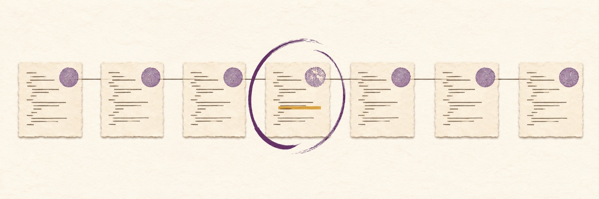

# kioku

[English](README.md) | Français

<picture>
  <source media="(prefers-color-scheme: dark)" srcset="docs/assets/banner-dark.jpg">
  
</picture>

**Kioku ne lance que les tests Rust qu'un changement peut atteindre — et refuse
de sauter tout ce qu'il ne peut pas prouver intact.**

[](https://github.com/Rushford444/kioku/actions/workflows/ci.yml)
[](LICENSE)

Kioku est un outil en ligne de commande, écrit en Rust, pour les équipes dont
`cargo nextest run` prend des minutes. On enregistre une fois un commit de base
vert. Ensuite, `kioku test` compare l'arbre de travail à cette base, parcourt un
graphe de dépendances fichier → fichier, et ne lance que les tests qui
atteignent un fichier modifié. Chaque test **non** lancé est écrit dans un
journal avec sa raison.

Ce n'est délibérément pas un sélecteur prédictif : il ne devine pas à partir de
l'historique, il n'entraîne pas de modèle, et un run partiel n'est jamais
présenté comme un vert complet. Quand la preuve manque, est ambiguë ou périmée,
il lance tout et le dit.

Kioku embarque aussi une seconde fonction, indépendante : **la réutilisation
d'un code de sortie sous traçage explicite**. `kioku run --trust-trace -- <cmd>`
peut réutiliser un code de sortie réussi quand un traceur épinglé montre que la
commande n'a touché ni le réseau, ni l'horloge, ni l'aléatoire, ni un fichier.
C'est réservé à Linux, désactivé par défaut, et honnête sur le fait d'être plus
lent qu'une commande triviale.

> **Le README complet, avec tous les chiffres mesurés, leurs commandes de
> rejeu et la liste détaillée des limites connues, est en anglais :
> [README.md](README.md).** Ce document en est le résumé fidèle.

## État

**v0.4.0.** La fonction validée est la sélection de tests Rust avec
Cargo/nextest, son CLI et son journal.

| Domaine | État en v0.4.0 |
| --- | --- |
| Sélection de tests Rust (`kioku select`, `kioku test`) | Validée : 8/8 portes natives, 12/12 cas de sûreté, un vrai run de workflow CI |
| Réutilisation de code de sortie sous traçage | Validée sur Linux aarch64 ; parseur x86_64 testé, rejeu de bout en bout non lancé |
| Sélection JS/TS | **Non implémentée.** `--runner vitest` est un repli suite complète, pas une sélection |
| Caches de build partagés (Cargo, JS, Next) | **Non implémentés** |
| macOS / Windows | Exécution seule. Pas de traçage |

## Installation

La v0.4.0 ne fournit **aucun binaire précompilé** : il n'y a pas encore de
release GitHub pour cette version. Compiler depuis les sources (Rust 1.89 ou
plus récent) :

```sh
git clone https://github.com/Rushford444/kioku.git
cd kioku
cargo build --release --locked
./target/release/kioku --version   # kioku 0.4.0
```

Ou l'installer dans le `PATH` :

```sh
cargo install --git https://github.com/Rushford444/kioku --locked
```

La crate n'est **pas publiée sur crates.io** (`publish = false`). Le nom du
paquet est `kdw-kioku` ; le binaire et la bibliothèque s'appellent `kioku`.

Pour les commandes de sélection, il faut aussi `git`, `cargo`,
[`cargo-nextest`](https://nexte.st/) et **`rust-analyzer`**. La construction du
graphe lance `rust-analyzer scip` et sonde `rust-analyzer --version` ; sans lui,
`kioku select base` échoue au lieu de construire un graphe partiel. Installez-le
avec `rustup component add rust-analyzer`.

## Démarrage rapide

Session réelle du binaire de release v0.4.0 sur macOS (arm64), dans un dossier
jetable. Rien n'est mis en cache par défaut : les deux appels exécutent.

```sh
mkdir -p /tmp/kioku-demo && cd /tmp/kioku-demo
git init -q
printf '#!/bin/sh\nprintf "checks passed\\n"\n' > check.sh
chmod +x check.sh
export KIOKU_DIR=/tmp/kioku-demo/cache
```

```text
$ kioku --version
kioku 0.4.0
$ kioku run -- ./check.sh
checks passed
kioku: execute-only (execute-only); effective mode: bytes
executed (exit 0, 286 ms)
$ kioku run -- ./check.sh
checks passed
kioku: execute-only (execute-only); effective mode: bytes
executed (exit 0, 5 ms)
$ kioku status
kioku: 0 trace states, 0 quarantines, 0 legacy entries
  legacy: 0 B, 0 ms legacy saved
  store: /tmp/kioku-demo/cache
  legacy hits: 0, misses: 0, executions: 0, invalidated: 0
```

Le second appel est plus rapide seulement parce que le cache de pages du
système est chaud : c'est toujours une exécution, pas un hit. Un script shell
n'a pas de corps ELF statique, donc la voie tracée le refuserait avec
`denial_reason: "executable-format"`.

## Sélection de tests Rust

C'est la fonction de la v0.4. Il faut un **commit de base propre et vert** et un
dossier de magasin conservé entre les runs.

```sh
# 1. Sur la branche de base, à un commit propre dont la suite est verte :
base=$(git rev-parse HEAD)
store="$HOME/.cache/kioku/select"
kioku select base --store "$store"

# 2. Obligatoire, toujours sur le commit de base : écrire le fichier des arêtes
#    apprises. --coverage-json prend une vraie couverture par test ; --run la
#    mesure maintenant.
kioku select learn --store "$store" --coverage-json /chemin/lignes-mesurees.json
#    (ou : kioku select learn --store "$store" --run)

# 3. Sur la branche de travail, inspecter le plan sans rien lancer :
kioku select plan --store "$store" --base "$base"

# 4. Lancer les tests sélectionnés :
kioku test --store "$store" --base "$base" --journal target/kioku-select/journal.json
```

**L'étape 2 n'est pas optionnelle.** C'est `kioku select learn` qui écrit
`learned-<commit>.json`, et `kioku test` refuse une base sans fichier appris :
il affiche `invalid base: … (kioku select base, puis select learn)` et lance
toute la suite en statut `incomplete`. C'est le comportement fail-closed qui
fonctionne comme prévu, mais un magasin construit avec `select base` seul ne
sélectionne rien. `--coverage-json` et `--run` sont tous deux des arguments
obligatoires de `learn` : il n'existe aucun moyen d'écrire un fichier appris
vide sans mesurer de couverture.

**Codes de sortie de `kioku test`** — à lire avant de le câbler dans une CI :

| Code | Sens |
| --- | --- |
| 0 | Vert partiel : les tests sélectionnés passent, les autres sont sautés |
| 1 | Rouge : un test sélectionné a échoué |
| 3 | Incomplet ou erreur de sélection — la suite complète a été lancée |
| 5 | Vert complet : toute la suite a tourné et passé |

Un vert partiel n'est **pas** un passage de CI. Gardez votre suite native comme
porte tant que votre consommateur n'interprète pas explicitement ces codes.

## Chiffres mesurés

Tous les chiffres du README anglais sont mesurés, jamais estimés, et chacun
porte sa source et sa commande de rejeu. Les deux tableaux qui comptent :

**Sélection de tests Rust (v0.4.0, commit `0bfa84f3`)** — base de 853 tests et
63 binaires, graphe de 511 arêtes et 1 218 racines, 44 074 paires statiques +
apprises. Un test neuf ajouté à l'arbre donne **70 décisions de lancement et 784
décisions de saut** (1 passé, 69 ignorés, 0 échoué, sortie 0, 569 ms). Portes
natives 8/8, suite native 787 passés / 69 ignorés sur le commit publié (784 sur `0bfa84f3`, avant les 3 tests du correctif de signal), campagne de sûreté 12/12 en
934 s.

**Réutilisation sous traçage (v0.3.0, inchangée en v0.4.0)** — 3 dépôts × 20
commits × 3 appels = 180 appels ; 60/60 hits au troisième appel, **0 faux vert**
sur 60 vérifications. Coût d'un hit : 48,4 ms de médiane, contre 50,9 ms pour
l'exécution d'une commande triviale — **le hit n'est pas plus rapide**. Contrôle
positif avec 0,4 s de vrai travail : 405,1 / 476,0 ms d'apprentissage contre
39,7 ms de médiane sur 5 hits, soit **10 à 12× plus rapide**.

**Ce qui n'est pas mesuré** : aucun banc froid/chaud et aucune revendication de
gain pour la sélection. Le 70/853 est une observation, pas un banc : il dit que
le sélecteur a choisi de lancer 8,2 % de l'inventaire, pas que votre suite ira
12× plus vite.

## Ce qui marche vraiment bien

- **Il échoue fermé, et il dit pourquoi.** Graphe manquant, magasin illisible,
  binaire neuf, fichier renommé, entrée ambiguë : chacun élargit le run au lieu
  de le rétrécir. Le journal nomme la raison de chaque test sauté.
- **La campagne de sûreté est adversariale.** 12 cas comparent la sélection à
  nextest natif sur le même arbre, dont des échecs volontaires, des tests neufs,
  un magasin corrompu et un fichier de graphe retiré. 12/12 passent, et le
  magasin est identique à l'octet avant et après.
- **Le magasin est scellé.** Base, graphe et arêtes apprises portent des
  empreintes de contenu ; un magasin altéré ou tronqué est refusé et le run
  s'élargit.
- **Le CLI est scriptable.** `--json` partout, schémas stables (`kioku/v1`,
  `kioku/select/v1`), codes de sortie de l'enfant propagés fidèlement (dont
  `128 + signal` sur Unix).
- **Aucun code `unsafe`.** `unsafe_code = "forbid"`, `clippy::pedantic` avec
  `-D warnings` en CI, `cargo-deny` pour les licences et les avis.

## Limites et problèmes connus

À lire avant d'adopter Kioku pour quoi que ce soit d'important.

- **Le graphe de la base est le seul graphe que construit la v0.4.0.**
  L'argument de conception est écrit en tête de `src/select/mod.rs` : un
  fichier ne gagne une arête sortante que s'il est modifié, donc un test qui
  atteint un fichier modifié est déjà sélectionné depuis le graphe de base. Cet
  argument suppose que le graphe de base est complet pour le commit de base. Une
  enquête ultérieure sur un vrai dépôt Rust a trouvé un cas où une arête
  présente seulement dans l'arbre de travail faisait sauter deux tests ; la
  conception a été changée **après** la v0.4.0 pour construire et unir un graphe
  HEAD. **La v0.4.0 ne contient pas ce correctif.** Traitez la sélection v0.4.0
  comme prudente mais non prouvée complète sur tout dépôt, et gardez la suite
  native comme porte.
- **`kioku select base` lance toute la suite une fois.** Sur un gros dépôt c'est
  l'étape chère, et il faut la refaire à chaque déplacement de la base.
- **`--coverage-json` est votre responsabilité.** Une couverture synthétique
  produit un graphe faux, donc des sauts faux.
- **`kioku select learn --run` laisse des fichiers `default_*.profraw` à la
  racine du dépôt.** Ce sont les profils de couverture du run instrumenté : ils
  ne sont pas nettoyés et salissent l'arbre, ce que le `kioku select base`
  suivant refuse. Supprimez-les avant de relancer `select base`.
- **Un changement dans un fichier de test élargit à toute la suite.** Vérifié :
  ajouter un `#[test]` dans `src/key_tests.rs` fait rapporter à
  `kioku select plan` 853 à lancer et 0 sauté, et `kioku test` rend un vert
  complet (sortie 5) après 854 tests. C'est la règle fail-closed qui fonctionne,
  pas un défaut, mais le sélecteur ne rapporte que sur des changements de source
  hors tests.
- **Un vert partiel n'est pas un passage de CI.**
- **`--runner vitest` est un repli, pas une sélection** : il lance toute la suite
  Vitest et rend quand même 3. Il n'y a pas de graphe JS/TS en v0.4.0.
- **Traçage : Linux aarch64 et x86_64 uniquement**, avec le binaire Debian
  strace 6.1 épinglé, et seulement des enfants ELF statiques little-endian sans
  interpréteur. Cela exclut `cargo test`, `node`, `pnpm` et la plupart des
  charges réelles.
- **Un hit ne réutilise qu'un code de sortie** : ni stdout, ni stderr, ni
  artefact. Utilisez `--require-output` quand la suite en a besoin.
- **~40 à 50 ms de surcoût par hit**, et **aucun rejeu x86_64 de bout en bout**
  n'a été lancé.
- **Aucun binaire précompilé v0.4.0 et aucune publication crates.io.**
- **Le magasin de sélection peut contenir des chemins sensibles.** Ne publiez
  pas ses archives sans relecture.

## Feuille de route

1. **Une vraie campagne de chronométrage pour la sélection** — paires alternées,
   seuil figé avant la mesure, publié tel quel y compris un NO-GO.
2. **Une union avec le graphe HEAD**, pour que l'hypothèse ci-dessus cesse
   d'être une limite.
3. **Sélection JS/TS** — Playwright et Vitest d'abord, puis `pytest`, puis
   `node --test`.
4. **Accélération de compilation** (mold, debuginfo, sccache), piste séparée et
   mesurée.

## Contribuer et licence

Voir [CONTRIBUTING.md](CONTRIBUTING.md), [SECURITY.md](SECURITY.md) et le
[journal des changements](CHANGELOG.md). Sous licence MIT ; voir [LICENSE](LICENSE).
