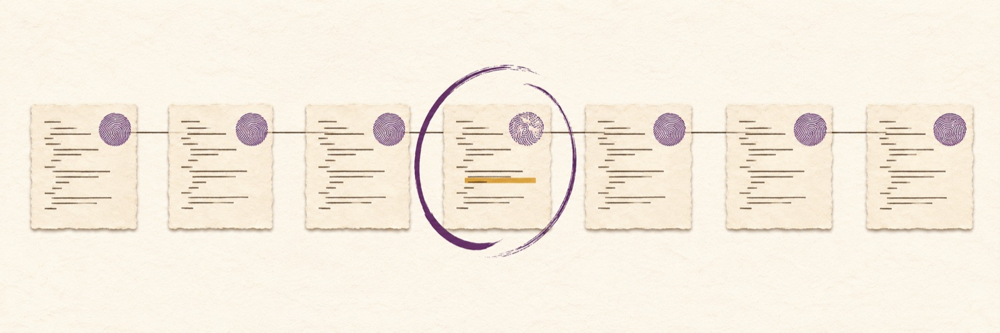

# Kioku

[English](README.md) | [Français](README.fr.md)

<picture>
  <source media="(prefers-color-scheme: dark)" srcset="docs/assets/banner-dark.jpg">
  
</picture>

**Kioku runs only the Rust tests a change can reach — and refuses to skip anything it cannot prove is unaffected.**

[](https://github.com/Rushford444/kioku/actions/workflows/ci.yml)

> **CI status — repair in progress.** The 0.4.0 source builds and its full test suite passes on Linux (787 passed, 69 ignored), but the public CI is not green yet: **Windows does not compile in 0.4.0** (the execute-only support described below is currently broken there), and 3 tests still depend on the maintainer's environment and fail on GitHub runners. Use Linux or macOS for now; no 0.4.0 release archives are published until the CI is green.
[](LICENSE)

Kioku is a local Rust CLI for teams whose `cargo nextest run` takes minutes. You
record a green base commit once. After that, `kioku test` compares your working
tree with that base, walks a file → file dependency graph, and runs only the
tests that reach a changed file. Every test it does **not** run is written to a
journal with its reason.

It is deliberately not a predictive selector. It does not guess from history, it
does not train a model, and a partial run is never reported as a full green.
When the evidence is missing, ambiguous or stale, it runs everything and says
so.

Kioku also ships a second, independent feature: **exit-status reuse under an
opt-in trace**. `kioku run --trust-trace -- <command>` can reuse a successful
exit status when a pinned tracer shows the command touched no network, clock,
randomness or file. It is Linux-only, it is off by default, and it is honest
about being slower than a trivial command. See
[Traced reuse](#traced-reuse-opt-in).

## Status

**v0.4.0.** The validated feature is Rust test selection with Cargo/nextest, its
CLI and its journal. Everything else in this README is either a documented
interface or an explicitly labelled limitation.

| Area | State in v0.4.0 |
| --- | --- |
| Rust test selection (`kioku select`, `kioku test`) | Validated: 8/8 native gates, 12/12 safety cases, one real CI workflow run |
| Exit-status reuse with opt-in tracing | Validated on Linux aarch64; Linux x86_64 parser tested, end-to-end replay not run |
| JS/TS test selection | **Not implemented.** `--runner vitest` is a full-suite fallback, not a selection |
| Shared build caches (Cargo, JS, Next) | **Not implemented** |
| macOS / Windows | Execute-only. No tracing, no selection-specific platform work |

## Install

v0.4.0 ships **no prebuilt binaries** — there is no GitHub release for it yet.
Build from source (Rust 1.89 or newer):

```sh
git clone https://github.com/Rushford444/kioku.git
cd kioku
cargo build --release --locked
./target/release/kioku --version   # kioku 0.4.0
```

Or install it onto your `PATH`:

```sh
cargo install --git https://github.com/Rushford444/kioku --locked
```

The crate is **not published on crates.io** (`publish = false`). The package
name is `kdw-kioku`; the binary and the library are both called `kioku`.

For the selection commands you also need `git`, `cargo`,
[`cargo-nextest`](https://nexte.st/) and **`rust-analyzer`**. The graph build
runs `rust-analyzer scip` and probes `rust-analyzer --version`; without it,
`kioku select base` fails rather than building a partial graph. Install it with
`rustup component add rust-analyzer`.

## Quickstart

This transcript is a real run of the v0.4.0 release binary on macOS (arm64), in
a throwaway directory. Nothing is cached by default: both invocations execute.

```sh
mkdir -p /tmp/kioku-demo && cd /tmp/kioku-demo
git init -q
printf '#!/bin/sh\nprintf "checks passed\\n"\n' > check.sh
chmod +x check.sh
export KIOKU_DIR=/tmp/kioku-demo/cache
```

```text
$ kioku --version
kioku 0.4.0
$ kioku run -- ./check.sh
checks passed
kioku: execute-only (execute-only); effective mode: bytes
executed (exit 0, 286 ms)
$ kioku run -- ./check.sh
checks passed
kioku: execute-only (execute-only); effective mode: bytes
executed (exit 0, 5 ms)
$ kioku status
kioku: 0 trace states, 0 quarantines, 0 legacy entries
  legacy: 0 B, 0 ms legacy saved
  store: /tmp/kioku-demo/cache
  legacy hits: 0, misses: 0, executions: 0, invalidated: 0
```

The second run is faster only because the OS page cache is warm — it is still an
execution, not a hit. A shell script has no static ELF body, so the traced path
would refuse it with `denial_reason: "executable-format"`.

## Rust test selection

This is the v0.4 feature. It needs a **clean, green base commit** and a store
directory you keep between runs.

```sh
# 1. On the base branch, at a clean commit whose suite is green:
base=$(git rev-parse HEAD)
store="$HOME/.cache/kioku/select"
kioku select base --store "$store"

# 2. Required, still on the base commit: write the learned-edges file.
#    --coverage-json takes real per-test coverage; --run measures it now.
kioku select learn --store "$store" --coverage-json /path/to/measured-lines.json
#    (or: kioku select learn --store "$store" --run)

# 3. On your work branch, inspect the plan without running anything:
kioku select plan --store "$store" --base "$base"

# 4. Run the selected tests:
kioku test --store "$store" --base "$base" --journal target/kioku-select/journal.json
```

`kioku select base` runs the full suite once and records the inventory, the
JUnit results and the file → file graph. `--coverage-json` takes a JSON object
mapping `"<binary> <test>"` to `{"<file>": [lines]}`; supply real per-test
coverage for that same base, never a synthesised one.

**Step 2 is not optional.** `kioku select learn` is what writes
`learned-<commit>.json`, and `kioku test` refuses a base that has no learned
file: it prints `invalid base: … (kioku select base, puis select learn)` and
runs the full suite with status `incomplete`. That is the fail-closed behaviour
working as designed, but it means a store built with `select base` alone selects
nothing. `--coverage-json` and `--run` are both required arguments of `learn`:
there is no way to write an empty learned file without measuring coverage.

**Exit codes for `kioku test`** — read them before wiring this into CI:

| Code | Meaning |
| --- | --- |
| 0 | Partial green: the selected tests passed, the rest were skipped |
| 1 | Red: a selected test failed |
| 3 | Incomplete or selection error — the full suite was run |
| 5 | Full green: the whole suite ran and passed |

A partial green is **not** a CI pass. Keep your native suite as the gate until
your consumer interprets these codes explicitly. `--native-exit-code` makes both
full and partial green return 0, so inspect `status` and `scope` instead.

An optional JSON proposal file for `kioku select plan --d1 FILE` or
`kioku test --d1 FILE` can add tests; proposed skips are ignored. This is not a
trained model, and the offline D1 observation stub is a library API, not an
inference or network service.

The journal records every test that was run or skipped, with the reason. See
[`docs/AGENTS-KIOKU.md`](docs/AGENTS-KIOKU.md) for the agent-facing contract and
[`docs/usage.md`](docs/usage.md) for the full CLI.

## Measured numbers

Every number below was measured, not estimated. Each row names its source and
the command that reproduces it. Where a measurement does not exist, the row says
so instead of guessing.

### Rust test selection — v0.4.0

Measured on commit `0bfa84f3` during the v0.4.0 release campaign. The product
code of the v0.4.0 tag **is** that commit: the only difference between
`0bfa84f3` and the tag is the version string in `Cargo.toml`/`Cargo.lock`. The
raw receipts are not published; the commands below reproduce the scenario.

| What | Value | Replay |
| --- | --- | --- |
| Base inventory | 853 tests, 63 test binaries | `kioku select base --store "$store"`, then read the base JSON |
| Dependency graph | 511 edges, 1 218 test roots | `kioku select plan --store "$store" --base "$base"` |
| Static + learned pairs | 44 074 (44 068 static + 6 learned), 0 tests without a root | `kioku select learn --store "$store" --coverage-json FILE` |
| One new test added to the tree | 70 run decisions, 784 skip decisions; 1 passed, 69 ignored, 0 failed; exit 0 | add one `#[test]` to an existing file, then `kioku test --store "$store" --base "$base"` |
| Decision cost | 569 ms total, 261 ms of it nextest | the `duration_ms` field of the `kioku test --json` event |
| Native gates | 8/8 exit 0 (build, fmt, clippy ×2, nextest ×2, doc, deny) | the gate block in [CONTRIBUTING.md](CONTRIBUTING.md) |
| Native suite | 787 passed, 69 ignored on the release commit (`--all-features`; 784 on `0bfa84f3`, before the signal fix added 3 unit tests) | `cargo nextest run --all-features --no-fail-fast` |
| Safety campaign | 12/12 cases PASS, 0 failed, 0 invalid, 934 s | see [Safety cases](#safety-cases) |
| Base capture / learn / compare | 204.726 s / 254.829 s / 15.516 s | `kioku select base`, `kioku select learn`, `kioku select plan` |

**What is not measured.** There is no cold/warm benchmark and no speedup claim
for the selection path. The 70/853 figure is one observation of one scenario on
one repository, not a benchmark: it says the selector chose to run 8.2 % of the
inventory, not that your suite will be 12× faster. A timing campaign with
alternating pairs and a threshold fixed in advance is on the roadmap, not in
this release.

### Traced exit-status reuse — v0.3.0, unchanged in v0.4.0

Source: [`docs/REPLAY-V03.md`](docs/REPLAY-V03.md), measured 2026-11-06 on Linux
aarch64, Rust 1.99.1, pinned Debian strace 6.1.

| What | Value | Replay |
| --- | --- | --- |
| Real-repository replay | 3 repositories × 20 commits × 3 invocations = 180 invocations | the `Reproduce` block in `docs/REPLAY-V03.md` |
| Third-invocation hit rate | 60/60 = 100 % | same |
| Per-invocation hit rate | 60/180 = 33.3 % (the first two invocations are discovery and confirmation) | same |
| False greens | 0 of 60 verifier runs | `kioku verify --trust-trace --verify-rate 1 -- <cmd>` |
| Discovery median | 239.0 ms (Rust CLI), 84.0 ms (Next.js app), 83.0 ms (fixture) | same |
| Hit cost | 48.4 ms median, 48.6 ms mean, 52.0 ms p95 | same |
| Trivial command, hit vs execution | 48.4 ms vs 50.9 ms — **the hit is not faster** | same |
| Positive control (0.4 s of real work) | learning 405.1 / 476.0 ms, 5 hits median 39.7 ms → **10–12× faster** | same |
| Dynamic commands | refused with `denial_reason: "executable-format"`, 0 false greens | same |

The honest summary: reuse pays off only when the command's own work is much
larger than the ~40–50 ms hit overhead. A `cargo test` is far above that
threshold but is dynamically linked and therefore **ineligible** for this trace
profile. A static checker that takes seconds is the intended case.

## What works well

- **It fails closed, and it says why.** Missing graph, unreadable store, new
  binary, renamed file, ambiguous input — every one of those widens the run
  instead of narrowing it. The journal names the reason for every skipped test,
  so a wrong skip is auditable rather than invisible.
- **The safety campaign is adversarial, not decorative.** 12 cases run the
  selector against native nextest on the same tree, including intentional
  failures, brand-new tests, corrupted store data and a deliberately removed
  graph file. All 12 pass, and the store is byte-identical before and after.
- **The store is sealed.** Base, graph and learned files carry content digests;
  a tampered or truncated store is refused and the run widens. A stale seal is
  never silently trusted.
- **The CLI is scriptable.** `--json` on every command, stable schemas
  (`kioku/v1`, `kioku/select/v1`), child exit codes propagated faithfully
  (including `128 + signal` on Unix), and a documented exit-code table for the
  selection path.
- **The traced path is genuinely conservative.** It refuses scripts, dynamic
  binaries, network, clock, randomness, unsupported IPC and file writes, and it
  refuses a distribution `strace` that is not the pinned build. 0 false greens
  across 60 verified runs.
- **No unsafe code.** `unsafe_code = "forbid"` in the manifest,
  `clippy::pedantic` with `-D warnings` in CI, `cargo-deny` for licences and
  advisories.

## Limitations and known issues

Read this section before adopting Kioku for anything that matters.

**Selection**

- **The base graph is the only graph v0.4.0 builds.** The design argument is
  written at the top of `src/select/mod.rs`: a file only gains an outgoing edge
  when it is modified, so a test that reaches a modified file is already
  selected from the base graph. That argument assumes the base graph is complete
  for the base commit. A later investigation on a real Rust repository found a
  case where an edge present only in the working tree caused two tests to be
  skipped; the design was changed **after** v0.4.0 to build and union a HEAD
  graph. **v0.4.0 does not contain that fix.** Treat v0.4.0 selection as
  conservative but not proven complete on every repository, and keep the native
  suite as the gate.
- **`kioku select base` runs the whole suite once.** On a large repository that
  is the expensive step, and it must be re-run whenever the base moves.
- **`kioku select learn` is mandatory and needs coverage.** A store built with
  `select base` alone selects nothing: `kioku test` refuses it and runs the full
  suite. `learn` requires either `--coverage-json` (real per-test coverage) or
  `--run` (an instrumented run of the base), so the first useful store costs two
  full runs of the base, not one.
- **`--coverage-json` is your responsibility.** Synthesised coverage produces a
  wrong graph and therefore wrong skips. Kioku cannot tell real coverage from
  plausible coverage.
- **`kioku select learn --run` leaves `default_*.profraw` files in the
  repository root.** They are coverage profiles from the instrumented run, they
  are not cleaned up, and they make the tree dirty — which the next
  `kioku select base` refuses. Delete them before re-running `select base`.
- **A change in a test file widens to the whole suite.** Verified: adding one
  `#[test]` to `src/key_tests.rs` made `kioku select plan` report 853 to run and
  0 skipped, and `kioku test` returned full green (exit 5) after running 854
  tests. That is the fail-closed rule working, not a bug, but it means the
  selector only pays off for changes to non-test source files.
- **A partial green is not a CI pass.** Exit 0 means "the tests I chose to run
  passed". Wire exit 5, or your own gate, if you need a full green.
- **`--runner vitest` is a fallback, not a selection.** It runs the whole Vitest
  suite (or a path-filtered subset) and still returns 3, because no base
  preparation exists for it. There is no JS/TS dependency graph in v0.4.0.

**Traced reuse**

- **Linux aarch64 and x86_64 only**, with the pinned Debian strace 6.1 binary.
  macOS and Windows execute only.
- **Static little-endian ELF children without an interpreter only.** Scripts and
  dynamically linked binaries are refused. That excludes `cargo test`, `node`,
  `pnpm` and most real workloads.
- **A hit reuses an exit status, nothing else.** No stdout, no stderr, no
  artifacts. Use `--require-output` when a later step needs them.
- **~40–50 ms of overhead per hit.** Not faster than a trivial command.
- **x86_64 end-to-end replay was never run.** The parser, denial codes and the
  static-ELF check are unit-tested with synthetic traces and a cross-compiled
  helper; the three-repository replay is aarch64 only.
- **`--trust-trace` is a caller assertion, not a proof of hermeticity.** vDSO
  clock reads, CPU randomness, shared memory and externally modified mapped
  pages may be invisible. The full list is in
  [Traced-reuse assumptions](#traced-reuse-assumptions).

**Platform and packaging**

- **No prebuilt v0.4.0 binaries and no crates.io release.** Build from source.
- **The package is named `kdw-kioku`** while the binary is `kioku`. A rename is
  a breaking change for anyone who already depends on the crate name.
- **The selection store may contain sensitive paths.** Do not publish or share
  store archives without review. Store digests are not an authentication
  mechanism, and selection is not a sandbox.

## Safety cases

The 12 cases the v0.4.0 campaign runs against native nextest. Each one asserts
that Kioku's decision matches what actually happens when the tests run:

| Case | What it proves |
| --- | --- |
| 1, 2, 3, 4 | A change in a leaf, a shared file, a config and a test file each select the right tests |
| A1, A2, A3 | A new test, a removed test and a renamed test are never silently dropped |
| A4, A4b | A tampered or truncated store is refused and the run widens |
| A5 | A test that disappears from the run is caught by the completeness oracle |
| S1 | A red test stays red — no partial green over a failure |
| S3 | A missing graph file yields `incomplete` (exit 3), never a green |

## Roadmap

Short and ordered, not dated:

1. **A real timing campaign for selection** — alternating pairs, a threshold
   fixed before the measurement, published as-is including a NO-GO.
2. **A HEAD graph union** so the base-graph assumption above stops being a
   limitation.
3. **JS/TS selection** — Playwright and Vitest first, then `pytest`, then
   `node --test`. Level 1 (faithful result reading, completeness oracle) before
   level 2 (dependency-based selection).
4. **Compilation acceleration** (mold, debuginfo, sccache) as a separate,
   measured track.

## Traced reuse (opt-in)

```sh
kioku run --require-output -- cargo test
kioku run --trust-trace -- /absolute/path/to/deterministic-check
kioku verify --trust-trace -- /absolute/path/to/deterministic-check
kioku quarantine reset -- /absolute/path/to/deterministic-check
kioku clean --older-than 7d
```

`--trust-trace` requires the assumptions below, an approved tracer and a
supported child; it is not a general cache-on switch. `--require-output` forces
execution. `verify` runs the command to compare the result with the cache
decision. `--verify-rate 1` checks every eligible hit, at the cost of executing
each one. `KIOKU_DISABLE=1` disables reuse. `KIOKU_DIR` changes the local store
location.

### Traced-reuse assumptions

`--trust-trace` is a caller assertion, not proof of hermeticity. The caller
asserts deterministic results for sources the tracer cannot observe, and that
all inputs and unobserved state remain stable during discovery, learning,
validation, execution and the skip window. This excludes transient and
concurrent writes. It also asserts that the result does not depend on atime,
process IDs, private anonymous memory, process scheduling and other observations
treated as benign by the supported profile. Directory order must remain stable
if it affects the result. vDSO clock reads, CPU randomness, shared memory and
externally modified mapped pages may be invisible. Hostile writers, privileged
processes, kernel attacks and tampering with the trusted local cache are outside
this contract. Do not opt in if any assertion is untrue or uncertain.

The tracer accepts only Linux aarch64 or x86_64 with the pinned Debian strace
6.1 binary for that architecture and a static little-endian ELF child without an
interpreter. The initial full environment is included in identity as a digest;
descendant arguments and environment are not captured and depend on the caller's
determinism assertion. An unrecognized syscall, unsupported flag or object,
incomplete process tree, trace truncation or ambiguity denies reuse. The trace
is not a sandbox. Discovery and learning occur across separate explicitly
opted-in invocations; new dependencies restart learning. Validation is not an
atomic filesystem snapshot. A failure with unknown child execution status must
not silently retry.

### Pinned tracer

Kioku tests one tracer build: the Debian strace 6.1 package for the host
architecture, unpacked and verified by SHA-256. A distribution `strace` is a
different build and is refused with `denial_reason: "tracer-untrusted"`.

Linux aarch64:

```sh
curl -fL -o strace_6.1-0.1_arm64.deb https://deb.debian.org/debian/pool/main/s/strace/strace_6.1-0.1_arm64.deb
echo "751817724af91cb95df566a21a154f9a7dcdd938e700e5cb9a5a47eb19752ea2  strace_6.1-0.1_arm64.deb" | sha256sum -c -
dpkg-deb -x strace_6.1-0.1_arm64.deb tracer
echo "0e69fa123b3d9732645ce1ac8c89819d100f83cdc9e52a80565d9ad8e7d8cf28  tracer/usr/bin/strace" | sha256sum -c -
export KIOKU_STRACE="$PWD/tracer/usr/bin/strace"
```

Linux x86_64: the same four steps with
`https://deb.debian.org/debian/pool/main/s/strace/strace_6.1-0.1_amd64.deb`,
package SHA-256 `1942d086a6244a1a9643489d3b0aa604ac44b88991d6c69217a63a193671bd4f`
and binary SHA-256 `aebaf212ce84a12208c5fa25f08c892029e6f6949b778da55e071ac145404a1e`.

## JSON and exit codes

The legacy commands' `--json` output uses schema `kioku/v1`. For `run` and
`verify`, kioku events go to stderr while the child's streams remain inherited.
Commands without a child write JSON to stdout; errors go to stderr. `--quiet`
reduces human output. Trace collection `trace_state: complete` is not a
cacheability decision: inspect `cacheable` and `denial_reason` as well.

For the legacy `run`, `verify` and related commands (not `kioku test`):

| Code | Meaning |
| --- | --- |
| 0 | Success |
| 1 | Child exited 1, or a process terminated without an exit code on a platform that reports none |
| 2 | Kioku usage error, or child exited 2 |
| 3 | Kioku internal error, or child exited 3 |
| 126 | Kioku could not execute the command, or child exited 126 |
| 127 | Kioku could not find the command, or child exited 127 |
| Other | Propagated child exit code |

On Unix a child killed by a signal is reported as 128 plus the signal number,
not as 1. A code alone cannot distinguish a child exit from a kioku error using
the same number. Arguments must be UTF-8.

## Configuration

Optional `kioku.toml` at the Git repository root matches an exact argument
vector:

```toml
[[commands]]
argv = ["cargo", "test"]  # exact command and arguments
mode = "bytes"            # conservative fingerprint mode
```

`ast` is an opt-in request; for traced reuse the effective mode remains bytes.
AST comparisons in `explain` are hypothetical recorded-entry analysis, not a
traced hit guarantee. See the [configuration reference](docs/configuration.md).

## CI and agents

A CI step can wrap a deterministic check without prompting:

```yaml
- name: Install kioku
  run: GIT_TERMINAL_PROMPT=0 cargo install --git https://github.com/Rushford444/kioku --locked
- name: Test
  run: kioku run -- cargo test
```

This is execute-only unless traced reuse is explicitly requested and eligible.
`CI=true` alone does not enable caching. Workflow configuration is not proof of
a remote run or a green candidate. A partial test selection is not a full CI
gate; see the exit codes above. For agent instructions in `AGENTS.md` or
`CLAUDE.md`:

```text
Install noninteractively: GIT_TERMINAL_PROMPT=0 cargo install --git https://github.com/Rushford444/kioku --locked
Use CI=true kioku --json run -- cargo test; do not expect a prompt.
Read kioku events from stderr and child stdout separately. Never assume a hit
replays output or artifacts; use --require-output when they are needed.
```

## FAQ

**Will this speed up `cargo test` by default?** No. Default execution always
runs, and Cargo is normally dynamically linked and ineligible for the trace
profile. The selection path is the one that skips work.

**Can I use a cached result to generate files?** No. A hit returns only a
successful exit status. Use `--require-output` or run the command directly.

**Can I use macOS or Windows?** The CLI supports execute-only operation there.
Traced reuse is Linux aarch64 and x86_64 only. Selection is platform-neutral but
was validated on Linux aarch64.

**Is `--trust-trace` a proof of hermeticity?** No. It is the caller's assertion
that the listed assumptions hold, including state the tracer cannot observe.

**What if verification detects a mismatch?** A command can be quarantined;
`kioku quarantine reset -- <exact command>` resets it and starts discovery again.

## Alternatives

Cargo's incremental build caching operates on build artifacts; kioku only reuses
an eligible command's exit status, without replaying artifacts. Tools such as
`sccache` cache compiler outputs and serve a different purpose. A CI cache
restores selected files and needs an explicitly chosen key; kioku's opt-in trace
instead observes a limited supported command profile locally. For test
selection, `cargo nextest` itself has no dependency-based selection; Kioku's
closest relatives are predictive selectors, which accept missing tests by
design — Kioku does not.

## Contributing and license

See [CONTRIBUTING.md](CONTRIBUTING.md), [SECURITY.md](SECURITY.md), and the
[change log](CHANGELOG.md). MIT licensed; see [LICENSE](LICENSE).
