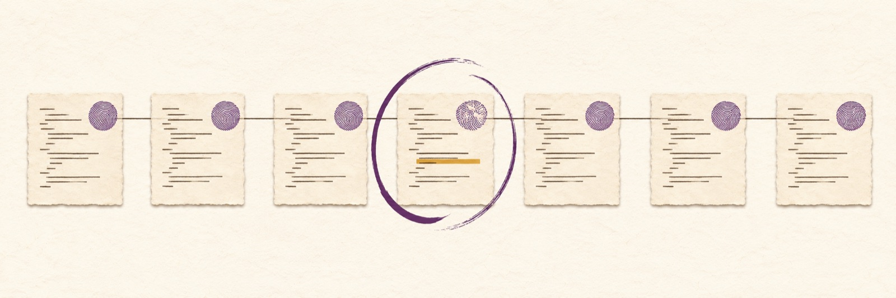

# kioku

[English](README.md) | [Français](README.fr.md)

<picture>
  <source media="(prefers-color-scheme: dark)" srcset="docs/assets/banner-dark.jpg">
  
</picture>

Kioku runs checks conservatively and can reuse a successful **exit status** when an explicitly trusted trace permits it.

[CI](https://github.com/Rushford444/kioku/actions/workflows/ci.yml)
[](LICENSE)
[](https://github.com/Rushford444/kioku/releases)

A developer runs a check, edits an unrelated file, then runs the same check
again while waiting for a review. An ordinary cache may miss a dependency that
changed outside the key it was given. Kioku starts by executing the command;
reuse requires an explicit assertion about determinism and stability. A hit does
not replay output or recreate artifacts. Do not use it when a later step needs either.

## Demo

Captured on Linux/aarch64 with kioku 0.1.0 and the pinned tracer
(sha256 `0e69fa12…cf28`). The helper is a static ELF checker, so it is
admissible for traced reuse. The first run records what the helper observes; the
second confirms those dependencies. The third run is a traced hit:
`cached (pass, 189 ms saved)`. A hit returns the cached successful exit status
only; it does not replay output.

```text
$ kioku run --trust-trace -- ./check input.txt
executed (exit 0, 157 ms)
$ kioku run --trust-trace -- ./check input.txt
executed (exit 0, 189 ms)
$ kioku run --trust-trace -- ./check input.txt
cached (pass, 189 ms saved)
$ kioku status
  counters: 1 hits (1 measured), 2 misses, 2 executions, 0 bypassed, 0 invalidated
  saved: 189 ms over 1 measured hit (includes tracing overhead)
```

The `saved` figure is measured against the traced execution it replaces and
includes tracing overhead. The helper's CPU loop makes the saving visible; it is
not a real workload and not a benchmark of `cargo test`. The script removes its
temporary directory at exit, and fails if a synthetic environment secret appears
in it.

[Full captured output](docs/demo-session.txt); reproduce it with
[`docs/demo.sh`](docs/demo.sh), which needs Linux aarch64, `cc`, `git` and
`KIOKU_STRACE` set to the pinned tracer. Timings vary.

## What it costs and what it does not do

- **Trace reuse is narrow.** Linux aarch64 or x86_64 only, with the pinned
  Debian strace 6.1 binary and a static little-endian ELF child without an
  interpreter. Scripts and normally linked commands such as `cargo test`,
  `node` or `clang` are not eligible: they execute and report
  `unsupported executable format` (`denial_reason: "executable-format"` in
  JSON).
- **A hit is not free.** The `kioku` process still starts, resolves the
  repository and reads the authenticated state, and that cost grows with the
  repository. Reuse pays only when the command's own work is larger than that
  overhead. A static checker that takes seconds is the intended case.
- **`cargo test` is not accelerated.** Cargo is dynamically linked and
  ineligible. Kioku does not speed up Cargo, CI caches or ordinary builds.
- **A hit returns only a successful exit status.** It does not replay stdout or
  stderr, create artifacts or recreate files.
- **The store is local and sensitive.** It is not portable across machines and
  is not a sandbox. `--trust-trace` is the caller's determinism assertion, not
  a proof.
- **The store must stay out of the work tree.** A `KIOKU_DIR` inside the
  repository turns the cache off: kioku runs the command, learns nothing and
  reuses nothing there, and it writes nothing in your files. A store left
  there by an earlier version stays where it is: `kioku clean` does not
  remove it, and its owner deletes it.

The [full limits](#how-it-works-and-limits) remain below; read them before
opting in.

## Install

Install from the pinned Git tag (Rust 1.89 or newer). While the repository is
private, Git credentials must be configured in advance; missing credentials fail
without prompting. The Cargo package is `kdw-kioku`; it is not published on
crates.io. The installed binary is `kioku`:

```sh
GIT_TERMINAL_PROMPT=0 cargo install --git https://github.com/Rushford444/kioku --tag v0.1.0 --locked
```

The installed binary is `kioku`. The same release publishes prebuilt archives
on the [GitHub Releases page](https://github.com/Rushford444/kioku/releases),
with one `SHA256SUMS` file:

| OS | Architecture | Archive name |
| --- | --- | --- |
| Linux | aarch64 | `kioku-0.1.0-linux-aarch64.tar.gz` |
| Linux | x86_64 | `kioku-0.1.0-linux-x86_64.tar.gz` |
| macOS | Apple silicon | `kioku-0.1.0-darwin-arm64.tar.gz` |
| macOS | Intel | `kioku-0.1.0-darwin-x86_64.tar.gz` |
| Windows | x86_64 | `kioku-0.1.0-windows-x86_64.zip` |

Both macOS archives run execute-only; tracing remains Linux aarch64 and
x86_64 only.

Download `SHA256SUMS` from the same release. Before extracting, compute the
archive hash and compare it to its matching line in `SHA256SUMS`:

```sh
sha256sum 'kioku-0.1.0-linux-aarch64.tar.gz'     # Linux aarch64
sha256sum 'kioku-0.1.0-linux-x86_64.tar.gz'      # Linux x86_64
shasum -a 256 'kioku-0.1.0-darwin-arm64.tar.gz'  # macOS Apple silicon
shasum -a 256 'kioku-0.1.0-darwin-x86_64.tar.gz' # macOS Intel
```

In PowerShell use `Get-FileHash .\kioku-0.1.0-windows-x86_64.zip -Algorithm SHA256`.
After a match, extract the archive and put `kioku` (or `kioku.exe`) on PATH.
Checksums detect corruption; their authenticity depends on how you obtained
the release and checksum file.

Build from a Git checkout instead:

```sh
git clone https://github.com/Rushford444/kioku.git
cd kioku
cargo install --path . --locked
```

Git installation requires network access and, for a private repository,
preconfigured Git credentials. Do not put credentials in a command or the repository.

The macOS binaries are not notarized. If a browser download adds quarantine and
Gatekeeper blocks launch, after verifying the checksum run
`xattr -d com.apple.quarantine kioku`, then `./kioku --version`. Cargo builds
do not carry the browser quarantine attribute.

## Quickstart

From a Git repository with Cargo installed:

```sh
kioku run -- cargo test
kioku explain -- cargo test
kioku status
```

The first command always runs. `explain` inspects a decision without running a
child. `cargo test` remains execute-only: it is dynamically linked and not
eligible for traced reuse. See the [usage guide](docs/usage.md) for details.

## Examples

```sh
kioku run --require-output -- cargo test
kioku run --trust-trace -- /absolute/path/to/deterministic-check
kioku verify --trust-trace -- /absolute/path/to/deterministic-check
kioku quarantine reset -- /absolute/path/to/deterministic-check
kioku clean --older-than 7d
```

`--trust-trace` requires the assumptions below, an approved tracer and a
supported child; it is not a general cache-on switch. `--require-output`
forces execution. `verify` runs the command to compare the result with the
cache decision. `--verify-rate 1` checks every eligible hit, at the cost of
executing each one. `KIOKU_DISABLE=1` disables reuse. `KIOKU_DIR` changes the
local store location; a store inside the work tree turns the cache off.

## Configuration

Optional `kioku.toml` at the Git repository root matches an exact argument vector:

```toml
[[commands]]
argv = ["cargo", "test"]  # exact command and arguments
mode = "bytes"            # conservative fingerprint mode
```

`ast` is an opt-in request; for traced reuse the effective mode remains bytes.
AST comparisons in `explain` are hypothetical recorded-entry analysis, not a
traced hit guarantee. See the [configuration reference](docs/configuration.md).

## CI and agents

A CI step can wrap a deterministic check without prompting:

```yaml
- name: Install kioku
  run: GIT_TERMINAL_PROMPT=0 cargo install --git https://github.com/Rushford444/kioku --tag v0.1.0 --locked
- name: Test
  run: kioku run -- cargo test
```

This is execute-only unless traced reuse is explicitly requested and eligible.
The runner needs Rust, Cargo, network access and preconfigured Git credentials while the repository is private. For agent
instructions in `AGENTS.md` or `CLAUDE.md`:

```text
Install noninteractively: GIT_TERMINAL_PROMPT=0 cargo install --git https://github.com/Rushford444/kioku --tag v0.1.0 --locked
Use CI=true kioku --json run -- cargo test; do not expect a prompt.
Read kioku events from stderr and child stdout separately. Never assume a hit
replays output or artifacts; use --require-output when they are needed.
```

`CI=true` alone does not enable caching. The repository's own
[CI workflow](https://github.com/Rushford444/kioku/blob/main/.github/workflows/ci.yml)
runs fmt, clippy, nextest, doc tests and cargo-deny on Ubuntu, macOS and
Windows, with separate Linux aarch64 and x86_64 traced jobs. A configured
matrix does not prove that remote jobs have run.

## JSON and exit codes

`--json` emits schema `kioku/v1`. For `run` and `verify`, kioku events go to
stderr while the child's streams remain inherited. Commands without a child
write JSON to stdout; errors go to stderr. `--quiet` reduces human output.
Trace collection `trace_state: complete` is not a cacheability decision: inspect
`cacheable` and `denial_reason` as well.

For example, `kioku --json status` on the empty demo store returned this single
stdout line (the store path depends on your setup):

```json
{"bytes":0,"cached_ms":0,"counters":{"bypassed":0,"executions":0,"hits":0,"invalidated":0,"measured_hits":0,"misses":0,"saved_ms":0,"schema":"kioku/counters/v1"},"entries":0,"event":"status","invalid_entries":0,"quarantines":0,"reason":null,"schema":"kioku/v1","store":"/tmp/kioku-demo/cache","trace_states":0}
```

The human `kioku status` output separates measured hits: `saved` is `unknown`
when no hit had a recorded duration, an empty store says `no hit yet`, and the
saved time only sums the hits whose learning run recorded a duration. A counters
document written before per-hit measurement reports `measured_hits: null`, and
its saved total is kept in `legacy_saved_ms` rather than attributed to new hits.

| Code | Meaning |
| --- | --- |
| 0 | Success |
| 1 | Child exited 1, or a process terminated without an exit code |
| 2 | Kioku usage error, or child exited 2 |
| 3 | Kioku internal error, or child exited 3 |
| 126 | Kioku could not execute the command, or child exited 126 |
| 127 | Kioku could not find the command, or child exited 127 |
| Other | Propagated child exit code |

Child exit codes are propagated, including 1, 2, 3, 126 and 127. A code alone
cannot distinguish a child exit from a kioku error using the same number.

Arguments must be UTF-8. JSON output and available options are described by
`kioku --help` and each subcommand's help.

## How it works and limits

Execute-only is the default. Only successful exit statuses can be reused, and
only with opt-in tracing under the strict conditions below. Unrecognized or
incomplete observations deny reuse; this reduces risk but is not a proof that
all influences are captured. The cache is local and not portable across
machines. Tracing is not a sandbox. An observed network, clock, randomness,
unsupported IPC, filesystem write or data-bearing stdin prevents reuse.
Unsupported platforms execute normally rather than using traced reuse.

The supported trace profile is Linux aarch64 or x86_64, a static little-endian
ELF child without an interpreter, and the pinned Debian strace 6.1 binary for
that architecture. Set `KIOKU_STRACE` to its absolute path. The recipe below is
the one CI uses. Scripts and dynamically linked children are not eligible: they
execute with `denial_reason: "executable-format"` and a human message, never a
silent fallback. Absolute symlinks, relative paths, `..` components and bare
PATH names are resolved before tracing, so the same command from a different
shell path reaches the same key. The complete initial environment is part of
the traced identity, and the manifest lists the files the child observes; no
option narrows either. Store paths and digests are sensitive; protect the store
as described in [SECURITY.md](SECURITY.md).

No timing or speedup figure is published: the measurements that once backed one
used a helper and repositories that were never released, so they were removed
instead of restated. What a reader can replay, and where the evidence stops, is
in [docs/REPLAY.md](docs/REPLAY.md). The x86_64 grammar is covered by unit tests
and one traced helper in CI; no x86_64 end-to-end replay was run on the build
host.

### Pinned tracer

Kioku tests one tracer build: the Debian strace 6.1 package for the host
architecture, unpacked and verified by SHA-256. A distribution
`strace` is a different build and is refused with
`denial_reason: "tracer-untrusted"`; the human message points here.

Linux aarch64:

```sh
curl -fL -o strace_6.1-0.1_arm64.deb https://deb.debian.org/debian/pool/main/s/strace/strace_6.1-0.1_arm64.deb
echo "751817724af91cb95df566a21a154f9a7dcdd938e700e5cb9a5a47eb19752ea2  strace_6.1-0.1_arm64.deb" | sha256sum -c -
dpkg-deb -x strace_6.1-0.1_arm64.deb tracer
echo "0e69fa123b3d9732645ce1ac8c89819d100f83cdc9e52a80565d9ad8e7d8cf28  tracer/usr/bin/strace" | sha256sum -c -
export KIOKU_STRACE="$PWD/tracer/usr/bin/strace"
```

Linux x86_64: the same four steps with
`https://deb.debian.org/debian/pool/main/s/strace/strace_6.1-0.1_amd64.deb`,
package SHA-256 `1942d086a6244a1a9643489d3b0aa604ac44b88991d6c69217a63a193671bd4f`
and binary SHA-256 `aebaf212ce84a12208c5fa25f08c892029e6f6949b778da55e071ac145404a1e`.

`dpkg-deb` ships with dpkg and is present in a Debian image. macOS and
Windows do not trace, so they need no tracer.

## Known limits in 0.1

The 0.1 release is not exhaustively verified. The test suite was checked against
a deliberately partial set of injected defects, so it cannot show that every
remaining defect would be caught. A few paths around input/output errors and
around the edge cases of the local store are covered only partially and were
left as they are for this release. These gaps do not establish whether defects remain. Reuse stays closed by
default — an observation that is missing, incomplete or unsupported denies
reuse. Nothing here changes the guarantees listed above.

## Traced-reuse assumptions

`--trust-trace` is a caller assertion, not proof of hermeticity. The caller
asserts deterministic results for sources the tracer cannot observe, and that
all inputs and unobserved state remain stable during discovery, learning,
validation, execution and the skip window. This excludes transient and concurrent
writes. It also asserts that the result does not depend on atime, process IDs,
private anonymous memory, process scheduling and other observations treated as
benign by the supported profile. Directory order must remain stable if it affects
the result. vDSO clock reads, CPU randomness, shared memory and externally
modified mapped pages may be invisible. Hostile writers, privileged processes,
kernel attacks and tampering with the trusted local cache are outside this
contract. Do not opt in if any assertion is untrue or uncertain.

`explain`, and `run` while caching is enabled, fingerprint every Git-visible
file for the AST diagnostic (`git ls-files --cached --others
--exclude-standard`). That reads regular files in that list, including untracked
files, but not ignored ones. A large tree adds I/O time, and a regular file held
under a write lease or on a slow filesystem can block the diagnostic. Ignore
expensive or blocking files when they do not affect the command.
`KIOKU_DISABLE=1` skips this diagnostic for `run`; `explain` still computes it.

The tracer accepts only Linux aarch64 or x86_64 with the pinned Debian strace
6.1 binary for that architecture and a static little-endian ELF child without an
interpreter. Scripts and dynamically linked children are ineligible. The initial
full environment is included in identity as a digest; descendant arguments and
environment are not captured and depend on the caller's determinism assertion.
An unrecognized syscall, unsupported flag or object, incomplete process tree,
trace truncation or ambiguity denies reuse. Observed network, clock, randomness,
unsupported IPC and filesystem writes deny reuse. The trace is not a sandbox.
Discovery and learning occur across separate explicitly opted-in invocations;
new dependencies restart learning. Validation is not an atomic filesystem
snapshot. A failure with unknown child execution status must not silently retry.
Traced and native execution are not promised equivalent. Sampling reduces risk
but is not proof of correctness.

## FAQ

**Will this speed up `cargo test` by default?** No. Default execution always
runs; Cargo itself is normally dynamically linked and ineligible for this trace profile.

**Can I use a cached result to generate files?** No. A hit returns only a
successful exit status. Use `--require-output` or run the command directly.

**Can I use macOS or Windows?** The CLI supports execute-only operation there;
traced reuse is Linux aarch64 and x86_64 only. Native CI results must be checked
on the workflow, not inferred from its configuration.

**Is `--trust-trace` a proof of hermeticity?** No. It is the caller's assertion
that the listed assumptions hold, including state the tracer cannot observe.

**What if verification detects a mismatch?** A command can be quarantined;
`kioku quarantine reset -- <exact command>` resets it and starts discovery again.

## Alternatives

Cargo's built-in incremental build caching operates on build artifacts; kioku
only reuses an eligible command's exit status, without replaying artifacts.
Tools such as `sccache` cache compiler outputs and serve a different purpose.
A CI cache restores selected files and needs an explicitly chosen key; kioku's
opt-in trace instead observes a limited supported command profile locally.

## Contributing and license

See [CONTRIBUTING.md](CONTRIBUTING.md), [SECURITY.md](SECURITY.md), and the
[change log](CHANGELOG.md). MIT licensed; see [LICENSE](LICENSE).
